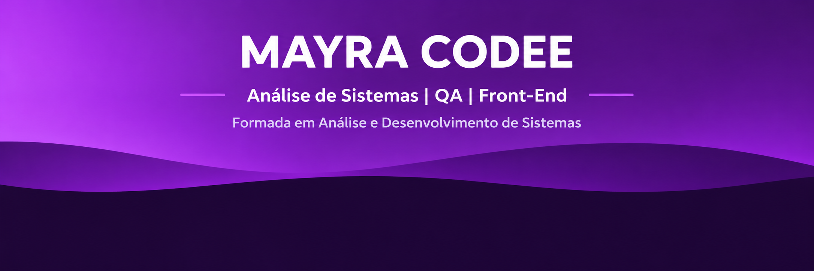

  

  <a href="https://www.linkedin.com/in/mayracodee/">LinkedIn</a>
  &nbsp; • &nbsp;
  <a href="https://mayracodee.vercel.app/">Portfólio</a>

---

<h2>💜 Sobre mim</h2>

Sou formada em Análise e Desenvolvimento de Sistemas e tenho interesse em Análise de Sistemas, Qualidade de Software (QA) e Desenvolvimento Front-End.

Gosto de investigar problemas, compreender o comportamento das aplicações, identificar inconsistências e buscar soluções. Acredito que entender como um sistema funciona é tão importante quanto desenvolver suas funcionalidades.

Tenho desenvolvido projetos práticos para aplicar meus conhecimentos em programação, integração de APIs, banco de dados e resolução de problemas.

<h2>🔍 Como trabalho com tecnologia</h2>

Gosto de compreender o problema antes de pensar na solução. Durante o desenvolvimento dos meus projetos, procuro seguir uma abordagem organizada:

<ul>
  <li>Entendimento do problema e levantamento de requisitos;</li>
  <li>Análise do comportamento da aplicação;</li>
  <li>Desenvolvimento e implementação de soluções;</li>
  <li>Identificação de erros e inconsistências;</li>
  <li>Testes, validação e melhorias contínuas.</li>
</ul>

<h2>🛠️ Stack & Ferramentas</h2>

<h3>Desenvolvimento Front-End</h3>

  

<h3>Banco de dados e ferramentas</h3>

  

<h3>Conhecimentos técnicos</h3>

<ul>
  <li>Desenvolvimento de interfaces responsivas;</li>
  <li>Consumo e integração de APIs REST;</li>
  <li>Operações CRUD;</li>
  <li>Autenticação e gerenciamento de dados;</li>
  <li>Lógica de programação e depuração de código;</li>
  <li>Fundamentos de qualidade e testes de software.</li>
</ul>

<h2>🚀 Projetos em destaque</h2>

<h3>💰 Finora — Gestão Financeira Pessoal</h3>

Aplicação web para gerenciamento financeiro pessoal, permitindo organizar despesas, compras, parcelas, cartões de crédito e categorias.

<strong>Tecnologias:</strong> React, JavaScript, Supabase e CSS.

<a href="https://github.com/mayracodee/finora">Ver repositório →</a>

<h3>🤖 DevFix AI — Análise Inteligente de Código</h3>

Assistente inteligente que utiliza IA para analisar códigos e mensagens de erro, identificar possíveis problemas, explicar suas causas e sugerir correções.

<strong>Tecnologias:</strong> React, TypeScript, Vite e API de IA.

<a href="https://github.com/mayracodee/devfix-ai">Ver repositório →</a>

<h3>🔎 JobFinder — Localizador de Empregos</h3>

Aplicação web para busca e consulta de oportunidades de emprego, com integração a uma API REST para obtenção de vagas.

<strong>Tecnologias:</strong> React, TypeScript, Vite e API REST.

<a href="https://github.com/mayracodee/JobFinder">Ver repositório →</a>

<h2>📚 Aprendizado contínuo</h2>

<ul>
  <li>Análise de Sistemas e levantamento de requisitos;</li>
  <li>Qualidade de Software e fundamentos de testes;</li>
  <li>JavaScript e TypeScript;</li>
  <li>React e desenvolvimento de aplicações web;</li>
  <li>Metodologias ágeis: Scrum e Kanban.</li>
</ul>

<h2>🌐 Vamos conectar?</h2>

  
  
  

  Transformando conhecimento em soluções, um projeto de cada vez. 💜

<!--
**mayracodee/mayracodee** is a ✨ _special_ ✨ repository because its `README.md` (this file) appears on your GitHub profile.

Here are some ideas to get you started:

- 🔭 I’m currently working on ...
- 🌱 I’m currently learning ...
- 👯 I’m looking to collaborate on ...
- 🤔 I’m looking for help with ...
- 💬 Ask me about ...
- 📫 How to reach me: ...
- 😄 Pronouns: ...
- ⚡ Fun fact: ...
-->
